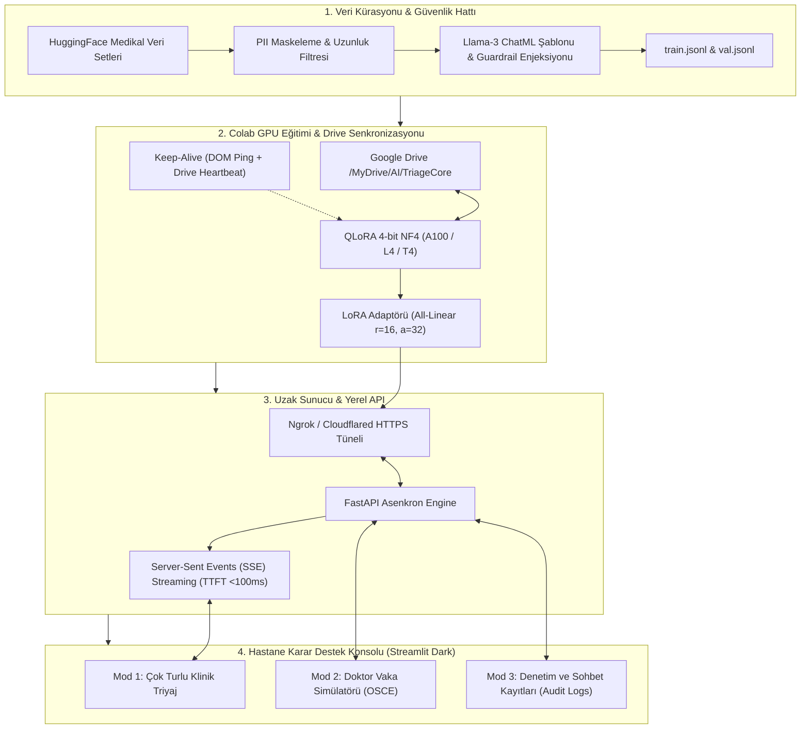

<div align="center">

# 🩺 TriageCore

### **Uçtan Uca Açık Ağırlıklı Tıbbi Triyaj ve Klinik Diyalog LLM Motoru**
*Production-Grade Open-Source Medical Triage Engine • Zero Proprietary APIs • 4-Bit QLoRA & PEFT • Hospital-Grade Dark CDSS Console*

<br/>

[](https://triagecore.streamlit.app/)
[](https://www.python.org/)
[](https://fastapi.tiangolo.com/)
[](https://streamlit.io/)
[](https://pytorch.org/)
[](https://github.com/huggingface/peft)
[](https://github.com/ggerganov/llama.cpp)
[](https://github.com/themuhammedguler/TriageCore/actions)
[](LICENSE)

<br/>

🌐 **Canlı Web Konsolu:** [triagecore.streamlit.app](https://triagecore.streamlit.app/)

<br/>

[Mimari Akış](#-mimari-ve-sistem-akışı) • [Colab & Drive Kılavuzu](#-google-colab-gpu--google-drive-entegrasyonu) • [OSCE Simülatörü](#-doktor-vaka-simülatörü-osce) • [Hızlı Başlangıç](#-hızlı-başlangıç) • [Mimari Kararlar (ADR)](#-mimari-karar-kayıtları-adr)

---

</div>

## 🎯 Proje Hedefi ve Klinik Triyaj Felsefesi

**TriageCore**, hiçbir ticari kapalı API'ye (OpenAI, Gemini, Anthropic vb.) bağımlı kalmadan, tamamen açık kaynak araçlar ve açık ağırlıklı modeller (**Meta Llama-3-8B-Instruct / Mistral-7B**) kullanılarak sıfırdan inşa edilmiş **üretim seviyesi (production-grade) bir klinik triyaj ve karar destek motorudur.**

Sistem, acil servislerde uluslararası kabul gören **ESI (Emergency Severity Index 1-5)** algoritmasını temel alarak hasta semptomlarını değerlendirir, kritik kırmızı bayrakları (*Red Flags*) yakalar ve anında aciliyet derecelendirmesi yapar:

| Seviye | ESI Tanımı | Klinik Anlamı | Yanıt Protokolü |
| :---: | :--- | :--- | :--- |
| **ESI-1** | **Resuscitation (Canlandırma)** | Akut Miyokard Enfarktüsü, İnme (FAST), Masif Kanama | Derhal 112/911 acil müdahale uyarısı |
| **ESI-2** | **Emergent (Çok Acil)** | Akut Karın (Apandisit), Şiddetli Solunum Sıkıntısı | Dakikalar içinde Acil Servis başvurusu |
| **ESI-3** | **Urgent (Orta Acil)** | İdrar yolu enfeksiyonu, kontrolsüz ateş, derin kesikler | 24 saat içinde poliklinik / tetkik |
| **ESI-4** | **Less Urgent (Düşük Aciliyet)** | Ayak bileği burkulması (basabilen), basit dikiş | Poliklinik randevusu / R.I.C.E. |
| **ESI-5** | **Non-Urgent (Acil Değil)** | Hafif viral üst solunum yolu enfeksiyonu, döküntü | Evde istirahat ve semptomatik bakım |

---

## 🏗️ Mimari ve Sistem Akışı



---

## ⚡ Google Colab GPU & Google Drive Entegrasyonu

Modeli yerel bilgisayara indirip donanımı yormak yerine **Google Colab (A100 / L4 / T4 GPU)** uzak çıkarım sunucusu olarak kullanılır:

1. **Google Drive `/MyDrive/AI/TriageCore` Kalıcı Depolama:**
   - Notebook'un **ilk hücresi** Google Drive'ı bağlar. Ara checkpoint'ler, eğitilen LoRA adaptörleri ve loglar doğrudan Drive'a yazılır.
   - Model bir kez eğitildikten sonra sonraki günlerde tekrar eğitime gerek kalmadan doğrudan son hücredeki sunucu çalıştırılabilir.
2. **Çift Katmanlı Keep-Alive (Oturum Koruma):**
   - Tarayıcı DOM'una 60 saniyede bir ping atan JavaScript enjeksiyonu ve her 2 dakikada bir Drive'a yazan Python daemon işçisi sayesinde Colab oturumu çökmez.
3. **Ngrok & Cloudflared Uzak Sunucusu (Son Hücre):**
   - FastAPI sunucusunu Colab GPU'su üzerinde ayağa kaldırır ve tek tıkla genel bir `https://xxxx.ngrok-free.app` adresi üretir.

---

## 🩺 Doktor Vaka Simülatörü (OSCE)

Sistemde iki yönlü klinik simülasyon motoru yer almaktadır:
* **Hekim Rolü:** Kullanıcı muayene eden hekimdir; model ise vaka karakterini canlandıran hastadır.
* **5 Gizli Klinik Vaka:** *Akut Apandisit, Akut Pulmoner Emboli, Akut Bakteriyel Menenjit, Akut Kolesistit, Diyabetik Ketoasidoz*.
* **İnteraktif Muayene ve İstemler:** Hekim hastaya ağrı yayılımını sorabilir, **Fizik Muayene** (*Rebound, McBurney, Murphy, Homans, Ense Sertliği*) ve **Laboratuvar/Radyoloji** (*BT, USG, D-Dimer, Kan Gazı, BOS Analizi*) isteyebilir.
* **Otomatik Puanlama (100 Üzerinden):** Kesin tanı doğruluğu, ESI triyaj seviyesi uyumu ve anamnez derinliği değerlendirilerek klinik ipuçları (*Clinical Pearls*) açıklanır.

---

## 🎨 Kurumsal Dark Mode Konsol (Streamlit CDSS)

Arayüz, yapay zeka klişelerinden (robot avatarları, oyuncak sohbet balonları) arındırılarak gerçek bir **Hastane Klinik Karar Destek Ekranı** standartlarında geliştirilmiştir:
* **WCAG AA/AAA Uyumlu Renk Paleti:** Derin obsidiyen taban (`#0B0F19`), koyu lacivert paneller (`#0F172A`), camgöbeği hekim vurguları (`#38BDF8`) ve zümrüt yeşili durum rozetleri.
* **Sıfır Kontrast Kaybı:** `.streamlit/config.toml` ile küresel karanlık tema kilitlenmiş, beyaz zemin parlaması ve okunaksız metin sorunu tamamen ortadan kaldırılmıştır.
* **Denetim Logları (Audit Trail):** Yapılan her triyaj sorgusu, vaka simülasyonu ve yanıt `logs/clinical_sessions.jsonl` kütüğüne kaydedilir ve arayüzden JSON olarak dışa aktarılabilir.

---

## 🚀 Hızlı Başlangıç

> 🌐 **Canlı Uygulama:** Projeyi yerel bilgisayarınıza kurmadan doğrudan bulutta test etmek için canlı sürümümüzü ziyaret edebilirsiniz: **[https://triagecore.streamlit.app/](https://triagecore.streamlit.app/)**

### 1. Ortamın Kurulumu (Modern `uv` ile)
```bash
# Projeyi klonlayın
git clone https://github.com/themuhammedguler/TriageCore.git
cd TriageCore

# Sanal ortamı oluşturun ve geliştirici bağımlılıklarını kurun
uv venv --python 3.11
uv pip install -e ".[dev]"
```

### 2. Test Süiti ve Yerel CI/CD Doğrulaması
```bash
# 20 birim ve entegrasyon testini çalıştırın
uv run pytest --verbose

# GitHub Actions hattını tek komutla yerelde test edin
python scripts/run_ci_local.py
```

### 3. FastAPI Servisini Başlatma
```bash
# Asenkron çıkarım sunucusunu başlatır (Swagger UI: http://localhost:8000/docs)
python scripts/serve.py
```

### 4. Kurumsal Dark Mode Klinik Konsolunu Açma
```bash
# Streamlit arayüzünü başlatır (http://localhost:8501)
streamlit run src/ui/app.py
```

---

## 🛡️ Mimari Karar Kayıtları (ADR)

Projedeki tüm mimari seçimler ve donanım gerekçeleri [docs/ARCHITECTURE_DECISIONS.md](docs/ARCHITECTURE_DECISIONS.md) altında belgelenmiştir:

* **[ADR-001]** Paket ve Sanal Ortam Yöneticisi Olarak `uv` Seçimi (10-100x Hız).
* **[ADR-002]** ChatML / Llama-3 Özel Kontrol Tokenları ve Guardrail Enjeksiyonu.
* **[ADR-003]** Klinik Veri Filtreleme, Regex PII Maskeleme ve OOM Önleme.
* **[ADR-004]** 4-Bit NormalFloat (NF4) ve Çift Kuantizasyon (16GB -> ~4GB VRAM).
* **[ADR-005]** Tüm Lineer Katmanlara LoRA Uygulanması (All-Linear LoRA).
* **[ADR-006]** Donanım Esnekliği (T4'te float16, A100/L4'te bfloat16 + FlashAttention-2).
* **[ADR-007]** Model Birleştirme (`merge_and_unload`) ile Sıfır Ek Gecikme.
* **[ADR-008]** GGUF Formatı ve `Q4_K_M` Kuantizasyonu.
* **[ADR-009]** FastAPI `asyncio.Semaphore` ile Eşzamanlılık ve Kuyruk Yönetimi.
* **[ADR-010]** Server-Sent Events (SSE) ile Düşük Gecikmeli Token Streaming.
* **[ADR-011]** Yapılandırılmış ESI 1-5 Aciliyet Şeması.
* **[ADR-012]** Türkçe Medikal NLP ve Ünlü Düşmesi (`göğüs -> göğsümün`) Desteği.
* **[ADR-013]** GitHub Actions Pipeline'ında `astral-sh/setup-uv` Kullanımı.
* **[ADR-014]** Otomatik Şema, Kalite ve Regresyon Koruması.
* **[ADR-015]** Yerel Pre-Push CI Runner (`scripts/run_ci_local.py`).
* **[ADR-016]** Google Drive `/MyDrive/AI/TriageCore` Kalıcı Yedekleme ve Otomatik Checkpoint Kurtarma.
* **[ADR-017]** Çift Katmanlı Colab Keep-Alive (DOM Ping + Drive Heartbeat Thread).
* **[ADR-018]** Sıfır Yerel Yük İçin Colab Ngrok / Cloudflared Uzak GPU Sunucusu.
* **[ADR-019]** "Zero-AI Look" Kurumsal Dark CDSS Konsolu ve OSCE Simülatörü.

---

## 📄 Lisans
Bu proje [MIT Lisansı](LICENSE) kapsamında açık kaynak olarak geliştirilmiştir.
TriageCore bir karar destek ve eğitim aracıdır; kesin tanı ve tedavi için yetkili bir hekim muayenesinin yerini almaz.
